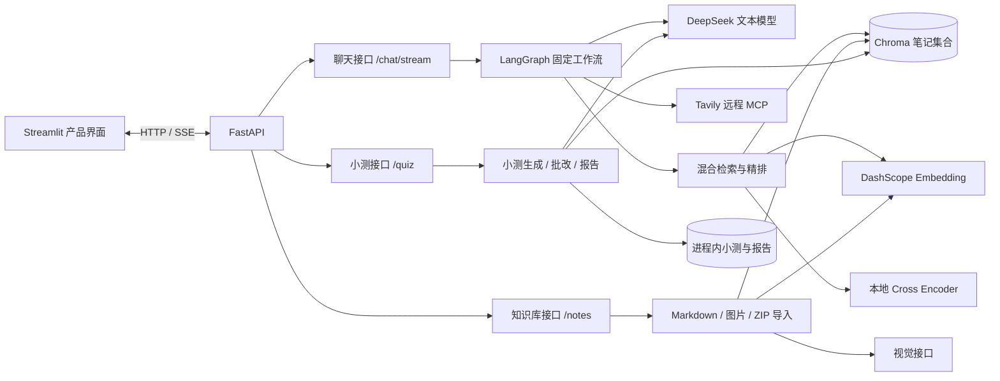
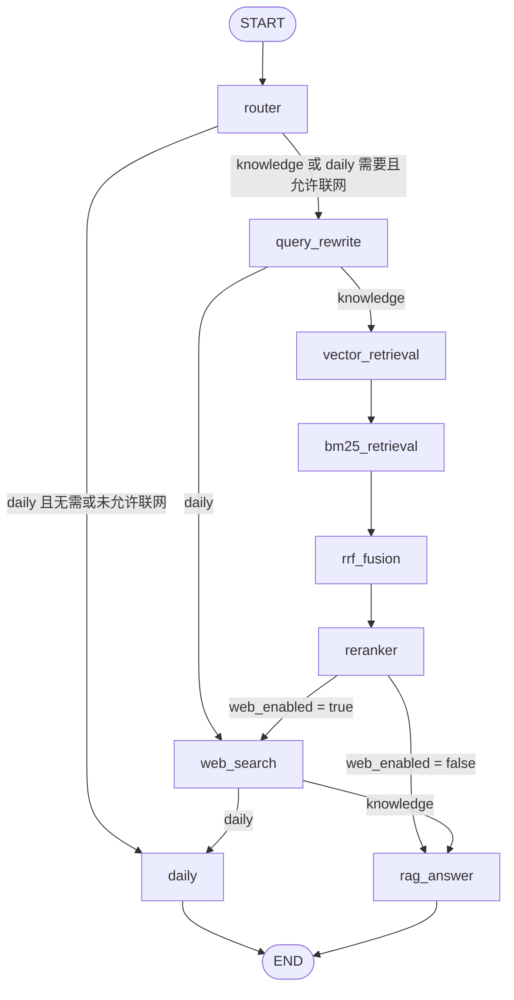
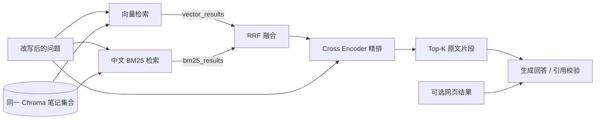
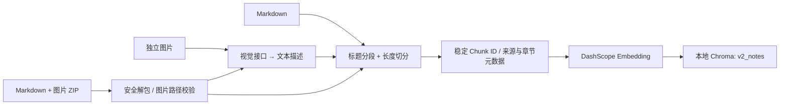

# 个人笔记复习助手 V2

把个人笔记变成有来源的问答、小测和复习报告，减少“资料存下了，却不知道怎么复习”的负担。

当前主版本是 **V2：LangGraph RAG Workflow + FastAPI + Streamlit**。导入 Markdown、图片或图文 ZIP 后，既能围绕原文提问，也能通过小测发现错误并生成复习建议。工作流由代码确定；Router 分类问题，不是模型自主选择工具的 Agent。

**发布状态：源码已发布，本机运行；V2 Streamlit Cloud 部署验证中。** [V2 详细说明](v2/README.md) · [发布验证](v2/RELEASE_VALIDATION.md) · [在线部署评估](docs/deployment/V2_ONLINE_DEPLOYMENT_ASSESSMENT.md) · [V1 历史文档](docs/history/V1_README.md)

## 从资料到复习的产品闭环

| 使用场景 | 已实现的行为 | 对用户的价值与边界 |
| --- | --- | --- |
| 知识库 | 导入 Markdown、独立图片、Markdown + 图片 ZIP；查看、删除资料 | 将自己的资料纳入复习；不提交个人文件或数据库 |
| 智能问答 | 个人笔记走混合检索，普通聊天与稳定知识解释走 daily | 笔记答案可回查文件、章节和片段；资料不足明确说明 |
| 受控联网 | 默认关闭；开启后实时问题按需使用 Tavily MCP，笔记问答可补充网页 | 笔记 `[1]` 与网页 `[W1]` 分开；搜索失败明确告知 |
| 智能小测 | 整篇代表性材料或指定章节；选择题、问答题；结构化生成与原文依据核对 | 从“看懂”转向回答和自测；整篇模式不承诺覆盖全部知识 |
| 学习报告 | 选择题评分、问答批改后整理错误、考点、混淆与复习建议 | 形成反馈闭环；题量不足或模型失败如实返回 |

## 真实界面预览

以下是已审核的 **实际 FastAPI + Streamlit 界面截图**，来自 Fake/Mock 浏览器联调。它们展示页面和交互流程，不代表真实模型回答质量；不含真实 Key、余额或个人笔记。当前没有可发布的独立知识库截图，因此不补造截图。

### 聊天与来源


### 智能小测


### 学习报告


## LangGraph 系统架构

Streamlit 服务端通过 HTTP/SSE 调用 FastAPI；后端编排模型、检索和 MCP。浏览器会话负责展示，资料与小测由后端管理。



### 聊天 Graph 的实际执行顺序



来源校验在回答函数和 API 内完成，不是额外 Graph 节点。小测、批改与报告是独立服务路径，不属于聊天 Graph。

关闭联网时任何分支都不搜索；开启时问候、情绪聊天等不强制搜索。Router 每轮清空旧检索与来源，避免切换开关或跨轮问答带入上轮资料。实时问题未联网、搜索失败或结果为空时，明确说明无法确认实时信息。Router 仍可能误判，可明确提问“根据我的笔记”。

## RAG 检索数据流

这里画的是**数据依赖**：Graph 先执行向量节点，再执行 BM25 节点，但 BM25 不消费向量候选，两路分别检索同一个笔记集合。



向量检索补充语义关联，BM25 保留术语匹配，RRF 合并候选排名，再由 `BAAI/bge-reranker-base` 精排选取片段。当前默认 Top-K 为 3；没有公开基准证明它优于其他参数，也没有宣称性能提升百分比。

模型 Token 经 SSE 增量展示；`sources` / `done` 需要通过引用检查，错误或断流返回 `error`，前端丢弃未完成草稿。来源编号校验能够发现无效引用，不能证明模型结论或网页内容必然正确。

## 多模态导入机制



Markdown 使用标题结构和 800/100 长度切分；稳定 Chunk ID 支持同一来源重复导入时更新并清理旧片段。ZIP 检查路径、文件数、压缩率和展开大小；图片转换为文本描述后进入检索，答案可保留图片来源。它属于基于视觉描述的图文检索，不是原生图像向量检索。完整真实批量图文识别质量仍需独立验收。

## 技术栈与设计取舍

| 层 | 实际使用 | 设计目的 |
| --- | --- | --- |
| 编排 | Python 3.12、LangGraph | 固定节点和条件边，便于追踪路由与离线回归 |
| 服务与页面 | FastAPI、Streamlit、httpx、SSE | 分开业务和展示，保留增量回答及明确完成状态 |
| 检索 | Chroma、DashScope `text-embedding-v4`、pkuseg / BM25、RRF、sentence-transformers / torch | 组合语义、词项与精排；代价是本地模型依赖与内存负担 |
| 文本与视觉 | DeepSeek 文本模型、视觉接口 | 文本生成与图像解释分别配置；文本 Key 验证不等于视觉验收 |
| 联网 | Tavily 官方远程 MCP `tavily_search` | 复用 MCP 接入，在明确开关下补充网页 |
| 小测 | 结构化输出、原文 quote 核对、批改缓存 | 限制无依据题目，失败可重试；仍需真实模型质量评估 |

V2 与 V1 业务独立，便于保留历史演进和评测。当前选择本机单用户、单 worker，资料落地 Chroma，小测与报告在进程内保存；没有加入生产鉴权、多租户或任务队列。公网演示需要补充费用限制和访客访问边界，详见部署评估。

## 测试与真实验收边界

2026-10-10 发布验证（发布基线 `30137fd`）：

| 验证 | 结果 | 能说明什么 |
| --- | --- | --- |
| V2 离线测试 | 152 项：150 通过、2 Windows 符号链接权限跳过，无失败 | Graph、RAG、导入、Quiz、API、来源与失败状态的工程回归 |
| 浏览器联调 | 30 项通过，Fake Model / Mock HTTP / 临时 Chroma | 实际前后端页面及协议联通 |
| Graph 场景脚本 | offline、acceptance、web-switch、note-import 均退出 0 | 指定场景路径通过 |

本次发布验证真实付费 API 请求为 0。Fake/Mock 不代表真实 Router 分类、答案准确率、网页时效、视觉识别或学习效果。使用已有 Python 3.12 环境，尚未验收全新环境完整安装。详细记录与离线命令见 [发布验证](v2/RELEASE_VALIDATION.md) 和 [V2 README](v2/README.md#离线回归)。原 V1 的历史评测留在独立文档，不作为 V2 指标。

## 本地启动

建议 Windows、Python 3.12 64 位，在仓库根目录运行：

```powershell
python -m venv .venv
.\.venv\Scripts\python.exe -m pip install -r v2/requirements.txt
```

参考 [环境变量示例](v2/.env.example)，在仓库根目录 `.env` 配置本人 `DEEPSEEK_API_KEY`、`DASHSCOPE_API_KEY`；联网另需 `TAVILY_API_KEY`。保留已有配置，不提交真实密钥。文本模型默认 `deepseek-v4-flash`，可用 `DEEPSEEK_TEXT_MODEL` 配置；图片需对应视觉能力。

```powershell
.\.venv\Scripts\python.exe -B -X utf8 v2/start_local.py
```

也可双击根目录 `start_v2.bat`。前端为 `http://127.0.0.1:8501`，API 文档为 `http://127.0.0.1:8000/docs`；Ctrl+C 停止两个服务。

必须安装 V2 requirements，根 requirements 仅服务原 V1 基础安装。torch 与精排模型较大，首次非空笔记问答可能下载模型；pkuseg 在部分 Windows 环境需要构建工具或兼容包。启动与健康检查不调用模型；提问、导入、搜索、小测、批改、报告及主动 Key 验证可能收费。更多安装限制见 [V2 运行说明](v2/README.md#windows-本机启动)。

Cloud 专用入口及会话隔离说明见 [Streamlit 部署说明](v2/deploy/README.md)。本机单用户入口保持原运行方式。

## 在线 Demo 与版本入口

- **V2：尚未部署公网。** 当前可阅读源码、截图并本机运行；[只读部署方案报告](docs/deployment/V2_ONLINE_DEPLOYMENT_ASSESSMENT.md)比较完整容器、前后端分开部署与展示站点。
- **V1 历史 Demo：** [Streamlit Cloud 地址](https://personalnotesreviewassistant-gcnvafbhbw8eqz5app2zqna.streamlit.app/)。本次未验证恢复状态，不能保证当前可用；它不代表 V2 功能。
- [V1 原 README 与历史评测说明](docs/history/V1_README.md)；保留 `backend/`、`streamlit_demo.py` 及原评测文件。

## 源码入口与当前限制

| 入口 | 职责 |
| --- | --- |
| [graph.py](v2/app/graph.py) | State、Router、节点与条件边 |
| [rag/](v2/app/rag/) | 检索、融合、精排、回答和引用校验 |
| [integrations/](v2/app/integrations/) | Tavily MCP、视觉服务 |
| [knowledge/](v2/app/knowledge/) | Markdown、图片和 ZIP 导入 |
| [quiz/](v2/app/quiz/) | 小测材料、生成、评分、报告 |
| [api/main.py](v2/app/api/main.py) | FastAPI 入口 |
| [frontend/app.py](v2/frontend/app.py) | Streamlit 入口 |

当前限制：会话共享本地知识库和供应商配置；小测、报告重启丢失；没有公网鉴权、用户隔离和持久任务；Linux 环境 Key 可支持业务，但 Windows 凭据设置页不能原样搬过去。资源占用、真实模型质量和完整图文批量识别仍需测量与验收。

后续方向：先完成受限演示模式和部署验证，再考虑用户隔离、数据持久化、小测覆盖率与真实评测。以上是待做方向，不是已实现功能。

[MIT License](LICENSE)
