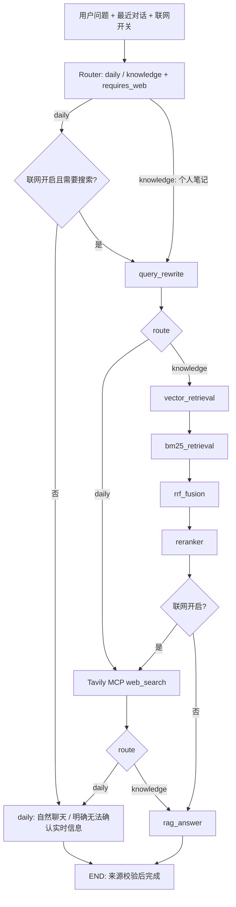
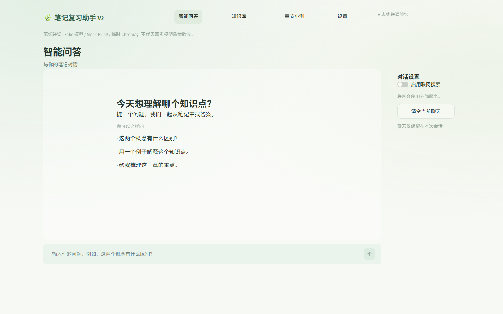
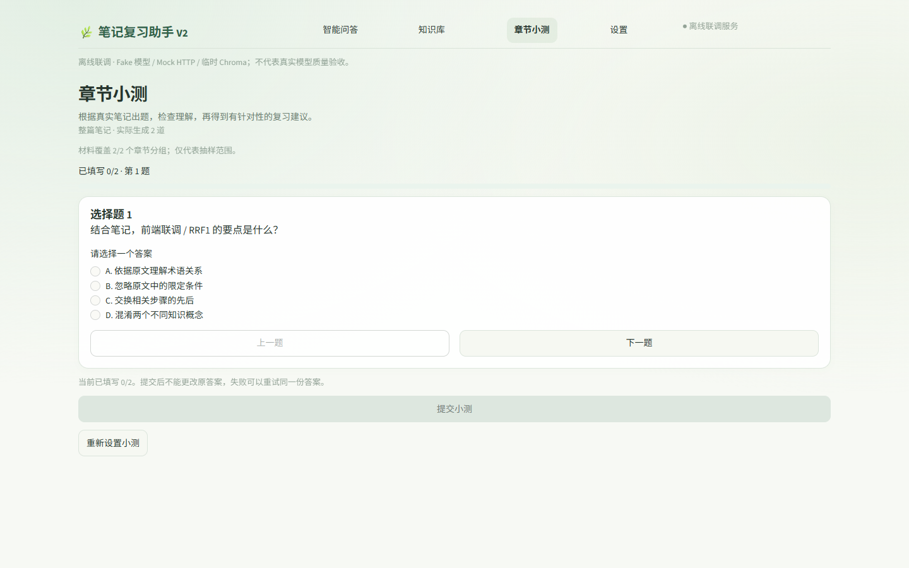
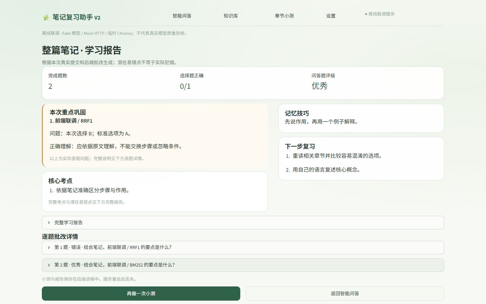

# 个人笔记复习助手 V2

V2 是本机运行的 **LangGraph RAG Workflow**：把个人资料导入知识库，进行带来源的问答、智能小测和学习报告。节点与工具连接由代码确定，不是自主决定工具调用的 Agent。

## 现有功能

- **混合检索**：查询改写 → DashScope 向量 + 中文 BM25 → RRF → Cross Encoder → Top-K → 有来源回答。
- **按需联网**：Tavily 官方远程 MCP 的 `tavily_search`；开关默认关闭。一般聊天和稳定知识解释不强制搜索，天气、最新新闻和明确联网请求在开关开启时搜索。
- **笔记问答**：明确要求根据个人笔记、上传资料或章节回答时走原 RAG；开启联网可结合网页补充。模型分类存在误判可能，提问可明确“根据我的笔记”。
- **资料导入**：Markdown、独立图片、Markdown + 图片 ZIP；标题/长度切分、稳定 Chunk ID、重复导入处理、图片来源与不安全路径拦截。
- **智能小测**：整篇或指定章节、选择题和问答题、结构化输出与原文依据核对、选择题评分和问答批改。
- **学习报告**：实际错误、核心考点、潜在混淆、记忆方法与复习建议；题量不足和模型失败如实返回。
- **FastAPI + Streamlit**：真实模型 Token 经 SSE 增量显示；只有引用校验通过才发送 `sources` / `done`，失败发送 `error`，前端丢弃未完成草稿。

## Graph 架构



Router 每轮清空旧检索与来源。搜索失败显示警告；日常实时问题不猜测最新事实，笔记问题可仅依据本地资料继续回答。没有可用网页时不编造来源。笔记使用 `[1]`，网页使用 `[W1]`，仅展示本轮实际引用的资料；编号核对不能证明网页内容或模型结论一定正确。

## Windows 本机启动

建议 Windows、Python 3.12 64 位。在**仓库根目录**运行：

```powershell
python -m venv .venv
.\.venv\Scripts\python.exe -m pip install -r v2/requirements.txt
```

`v2/requirements.txt` 包含根基础依赖、LangGraph、MCP、pkuseg 和 Cross Encoder/torch，不只安装根 requirements.txt。torch 与精排模型体积较大；首次非空笔记问答可能下载 `BAAI/bge-reranker-base`。依赖安装需网络；离线测试使用 Mock，不下载精排模型。pkuseg 在部分 Windows 环境可能需要构建工具或兼容的预编译包；本次验证使用现有 Python 3.12 环境，未宣称全新环境安装已验收。

配置仓库根目录 `.env`（不要覆盖已有配置）：参考 [公开示例](.env.example)，填写本人的 `DEEPSEEK_API_KEY`、`DASHSCOPE_API_KEY`，联网时另配置 `TAVILY_API_KEY`。示例只含占位符。文本模型默认 `deepseek-v4-flash`，可用 `DEEPSEEK_TEXT_MODEL` 配置；图像输入还需要账户对应的视觉服务能力，文本 Key 验证不代表视觉功能验证通过。

```powershell
.\.venv\Scripts\python.exe -B -X utf8 v2/start_local.py
```

或双击根目录 `start_v2.bat`。启动器生成本机设置令牌并同时运行两个服务：

- 前端：<http://127.0.0.1:8501>
- API / Swagger：<http://127.0.0.1:8000/docs>

Ctrl+C 停止两个服务。启动和健康检查不调用模型；提问、资料导入、Tavily 搜索、小测、批改、报告和主动 Key 验证可能产生费用。

只调试 API 时可运行：

```powershell
.\.venv\Scripts\python.exe -B -m uvicorn app.api.main:app --app-dir v2 --host 127.0.0.1 --port 8000 --workers 1
```

该命令未生成本机设置令牌，设置写入不可用；完整前端与设置流程使用启动器。

## 存储与部署边界

- 正式向量库：DashScope `text-embedding-v4`，1024 维，Collection `v2_notes`，目录 `v2/data/chroma`；用户文件在 `v2/data/uploads`。不提交数据库或用户文件。
- Windows 同用户已验证凭据优先于环境配置。DashScope 删除保存项后回退环境 Key，显示未验证；DeepSeek 显式删除会禁用自动环境回退。Tavily 从根 `.env` 读取。
- 本机可信单用户、API 单 worker；设置接口依赖 loopback 与随机令牌。没有生产鉴权、租户隔离或分布式任务。
- 小测与报告保存在后端进程内，重启失效。聊天与草稿在 Streamlit 会话中，浏览器刷新不承诺保留。
- **GitHub 发布源码不等于线上部署。** 根目录 Streamlit Cloud Demo 属于 V1，不代表 V2；本次不变更 Cloud 配置，不开放本机 API 公网访问。公网部署仍需独立鉴权、持久化与部署设计。
- 图文 ZIP 的完整真实批量识别与模型质量仍需单独验收；本次联网修复仅做 Fake/Mock 离线验证，未调用真实付费 API。

## 离线回归

从仓库根目录运行：

```powershell
.\.venv\Scripts\python.exe -B -X utf8 -m unittest discover -s v2/tests -p 'smoke_*.py'
.\.venv\Scripts\python.exe -B -X utf8 v2/tests/smoke_graph.py --offline
.\.venv\Scripts\python.exe -B -X utf8 v2/tests/smoke_graph.py --offline --acceptance
.\.venv\Scripts\python.exe -B -X utf8 v2/tests/smoke_graph.py --offline --web-switch
.\.venv\Scripts\python.exe -B -X utf8 v2/tests/smoke_graph.py --offline --note-import
```

Graph 脚本必须加 `--offline`，否则会尝试真实模型。新增 `smoke_daily_web.py` 覆盖联网开关、实时查询、普通聊天、笔记 RAG、空结果/失败、跨轮状态、网页引用、模型错误及 Token 在模型结束前到达。Fake Router 验证工程路径，不能替代真实模型分类质量评测。

可选浏览器测试需要 Node.js、Playwright 和已安装 Edge：

```powershell
npm install --prefix v2/tests
node v2/tests/browser_e2e.cjs
```

脚本启动临时端口 8019 / 8519，使用 Fake Model、Mock HTTP、临时 Chroma 和独立 Windows 测试凭据。可通过 `V2_TEST_PYTHON` 指定测试解释器；生成结果位于被忽略的 `v2/acceptance/`。浏览器测试不使用实际业务凭据。

## 文件入口

| 路径 | 内容 |
| --- | --- |
| `app/graph.py` | State、Router、条件边与节点编排 |
| `app/rag/` | 向量 / BM25 / RRF / 精排 / 回答与来源校验 |
| `app/integrations/` | Tavily MCP 与视觉接口 |
| `app/knowledge/` | Markdown、图片、ZIP 导入 |
| `app/quiz/` | 章节材料、小测、批改、报告与进程内存储 |
| `app/api/main.py` | FastAPI 入口；同目录有 SSE、知识库、小测与设置接口 |
| `frontend/app.py` | Streamlit 入口；同目录有 HTTP 客户端、页面和报告展示 |
| `tests/` | 离线回归与可选浏览器测试 |

更多说明：[API 与 SSE](app/api/README.md) · [资料导入](app/knowledge/README.md) · [智能小测](app/quiz/README.md) · [前端](frontend/README.md) · [发布验证](RELEASE_VALIDATION.md)

## 界面预览

以下截图来自 Fake/Mock 的实际 FastAPI + Streamlit 联调，只展示产品流程，不证明真实模型质量。未包含真实 Key、余额或个人学习资料。




