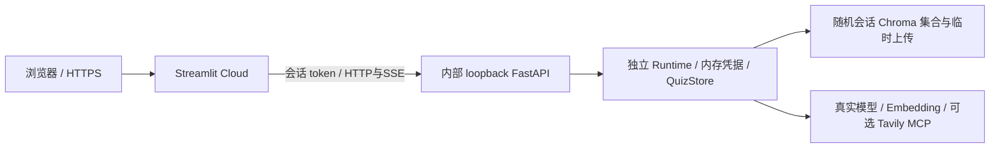

# Streamlit Community Cloud V2 入口

本目录提供云端演示入口，复用正式 V2 Graph、FastAPI HTTP/SSE 与 Streamlit 页面；不涉及 V1 入口，也不开放开发者本机 API。

## Cloud 部署配置

- Repository：`yuyuyuoo55/Personal_Notes_Review_Assistant`
- Branch：`main`
- Main file path：`v2/deploy/cloud_app.py`
- Python：`3.12`
- 依赖：入口同目录 `requirements.txt`，包含 V2 工作流依赖；CPU torch，不去掉 BM25 或精排。Cloud 中文分词使用维护中的 `spacy-pkuseg` fork（默认 OntoNotes 模型），本机入口继续使用原 pkuseg。
- 不填写平台供应商 Secret；访客在设置页使用自己的 DeepSeek/百炼 Key。Tavily 在页面底部的“云端联网配置”单独配置。

Cloud 从仓库根目录执行 Streamlit，优先搜索入口同目录依赖，见 [文件组织](https://docs.streamlit.io/deploy/streamlit-community-cloud/deploy-your-app/file-organization) 和 [依赖规则](https://docs.streamlit.io/deploy/streamlit-community-cloud/deploy-your-app/app-dependencies)。

## 实际运行形态



内部 uvicorn 在同一 Cloud 进程的后台线程启动，随机 loopback 端口；Streamlit rerun 复用 resource cache，不为每位访客创建服务器或加载额外精排模型。所有 API 请求必须带注册的随机会话 token，不回退默认共享 Runtime。SSE 保持逐帧，不使用 TestClient 代替线上 HTTP。

## 访客使用与隐私边界

1. 设置页输入本人 DeepSeek / 百炼 Key，勾选一次验证及可能费用，主动点击验证；未配置时不会自动调用供应商。
2. 在知识库导入非敏感示例，提问、小测、批改和报告保持原真实业务；使用 Key 所属账户额度，未承诺免费模型。
3. 需要联网时另配置本人 Tavily Key；空 Key 不使用平台或环境的搜索密钥。保存 Tavily 不发请求，联网提问才搜索。

各会话密钥仅在服务器内存中，资料、小测、报告不跨浏览器共享。输入的 Key 会发送到演示服务及相应供应商，不能保证刷新后的会话保留。闲置 30 分钟后清理；休眠/重启可能清空所有演示数据。没有永久备份、用户登录或生产多租户承诺。关闭浏览器不会立即通知服务器，清理由闲置超时完成。

演示限制：最多 8 个活跃会话；每会话最多 90 个 HTTP 请求/分钟；全局一次只执行一个业务任务；单次上传请求最多 5 MiB，上传目录累计 20 MiB（图文 ZIP 展开受既有导入安全上限约束，展开文件可能使下一次上传达到累计上限）。精排完整保留，但首次模型下载、内存峰值、免费 Cloud 休眠可能导致慢启动或失败，不能把健康页成功当成全链路验收。

## 平台构建修复

首次构建因 PyTorch 额外索引遮蔽普通 PyPI 依赖，以及旧 pkuseg 隔离构建缺 NumPy 而失败。Cloud 改用官方 CPU wheel 直链和提供 Python 3.12 Linux wheel 的 [spaCy pkuseg fork](https://github.com/explosion/spacy-pkuseg)，没有删除 BM25 / 精排。fork 的分词模型与本机原默认模型不同，检索质量不能视为完全相同；首次使用会下载公开分词模型。

## 本次验证

- 完整离线回归：167 项，165 通过、2 Windows 符号链接权限跳过，无失败；新增 15 项 Cloud 检查。
- Cloud 检查：未知 token、跨会话密钥/同名文件/笔记/小测隔离、禁用环境 Key 回退、Tavily 显式 Key、设置删除、过期清理、限流、上传限制、done/error，以及真实内部 HTTP 的首个 Token 在 Fake 模型完成前抵达。
- 原正式前端 30 项 Fake/Mock 浏览器联调全部通过，无浏览器异常。
- Streamlit AppTest：入口加载无异常，Cloud health 已连接；未填 Key、未调用模型。
- Linux Python 3.12 依赖解析成功（163 包），不等于 Linux 实际安装或模型内存验证；本机没有可用 Linux 环境，安装以 Cloud 构建日志为准。
- 真实供应商调用：0。真实模型分类、检索质量、视觉、小测质量与 Cloud 精排内存仍需另行有限额度验收。

本机验证可运行：

```powershell
.\.venv\Scripts\python.exe -B -X utf8 -m unittest discover -s v2/tests -p 'smoke_*.py'
.\.venv\Scripts\python.exe -m streamlit run v2/deploy/cloud_app.py --server.address 127.0.0.1
```

第二条仅供开发者本机模拟云入口，健康检查不发供应商请求。生产部署使用平台 HTTPS，内置 API 永远不直接公网监听。
