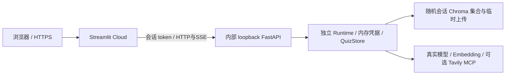

# Streamlit Community Cloud V2 入口

本目录提供云端演示入口，复用正式 V2 Graph、FastAPI HTTP/SSE 与 Streamlit 页面；不涉及 V1 入口，也不开放开发者本机 API。

**在线地址：[打开 V2 演示](https://personal-notes-review-v2.streamlit.app/)**。2026-10-10 已验证实际 Cloud 构建、首页“云端会话已连接”、设置页和独立未登录浏览器访问；真实供应商 Key 未配置，尚未进行真实 AI 全链路验收。

## Cloud 部署配置

- Repository：`yuyuyuoo55/Personal_Notes_Review_Assistant`
- Branch：`main`
- Main file path：`v2/deploy/cloud_app.py`
- Python：`3.12`
- 依赖：入口同目录 `requirements.txt`，包含 V2 工作流依赖；CPU torch，不去掉 BM25 或精排。Cloud 中文分词使用维护中的 `spacy-pkuseg` fork（默认 OntoNotes 模型），本机入口继续使用原 pkuseg。
- 平台 Secrets 配置演示者的 `DASHSCOPE_API_KEY` 与 `TAVILY_API_KEY`；不配置共享 DeepSeek Key。访客只能在设置页配置自己的 DeepSeek。共享 Key 不向页面返回，百炼写入/删除接口禁止访客使用。

Cloud 从仓库根目录执行 Streamlit，优先搜索入口同目录依赖，见 [文件组织](https://docs.streamlit.io/deploy/streamlit-community-cloud/deploy-your-app/file-organization) 和 [依赖规则](https://docs.streamlit.io/deploy/streamlit-community-cloud/deploy-your-app/app-dependencies)。

## 实际运行形态



内部 uvicorn 在同一 Cloud 进程的后台线程启动，随机 loopback 端口；Streamlit rerun 复用 resource cache，不为每位访客创建服务器或加载额外精排模型。所有 API 请求必须带注册的随机会话 token，不回退默认共享 Runtime。SSE 保持逐帧，不使用 TestClient 代替线上 HTTP。

## 访客使用与隐私边界

1. 设置页只需输入本人 DeepSeek Key，勾选一次验证及可能费用，主动点击验证；未配置时不会自动调用供应商。
2. 新会话自动获得公开示例，可直接选择它提问或按章节出题，也可导入自己的非敏感资料。提问、小测、批改和报告保持原真实业务；DeepSeek 使用访客账户额度，百炼使用演示者额度，未承诺免费模型。
3. 联网默认关闭；开启后按需使用演示者的 Tavily Key。百炼与 Tavily 仅从平台 Secrets 明确读取，不使用本机 .env；未配置或额度耗尽时明确返回失败。免费额度不是应用自动保证，演示者应在供应商账户设置费用与额度限制。

访客 DeepSeek 密钥仅在服务器会话内存中；演示者的百炼与 Tavily Key 保存在平台 Secrets，资料、小测、报告不跨浏览器共享。输入的 Key 会发送到演示服务及相应供应商，不能保证刷新后的会话保留。闲置 30 分钟后清理；休眠/重启可能清空所有演示数据。没有永久备份、用户登录或生产多租户承诺。关闭浏览器不会立即通知服务器，清理由闲置超时完成。

演示限制：最多 8 个活跃会话；每会话最多 90 个 HTTP 请求/分钟；全局一次只执行一个业务任务；单次上传请求最多 5 MiB，上传目录累计 20 MiB（图文 ZIP 展开受既有导入安全上限约束，展开文件可能使下一次上传达到累计上限）。精排完整保留，但首次模型下载、内存峰值、免费 Cloud 休眠可能导致慢启动或失败，不能把健康页成功当成全链路验收。

## 平台构建修复

首次构建因 PyTorch 额外索引遮蔽普通 PyPI 依赖，以及旧 pkuseg 隔离构建缺 NumPy 而失败。Cloud 改用官方 CPU wheel 直链和提供 Python 3.12 Linux wheel 的 [spaCy pkuseg fork](https://github.com/explosion/spacy-pkuseg)，没有删除 BM25 / 精排。fork 的分词模型与本机原默认模型不同，检索质量不能视为完全相同；首次使用会下载公开分词模型。

## 本次验证

- 完整离线回归：168 项，166 通过、2 Windows 符号链接权限跳过，无失败；新增 16 项 Cloud 检查。
- Cloud 检查：未知 token、跨会话密钥/同名文件/笔记/小测隔离、禁用环境 Key 回退、Tavily 显式 Key、设置删除、过期清理、限流、上传限制、done/error，以及真实内部 HTTP 的首个 Token 在 Fake 模型完成前抵达。
- 原正式前端 30 项 Fake/Mock 浏览器联调全部通过，无浏览器异常。
- Streamlit AppTest：入口加载无异常，Cloud health 已连接；未填 Key、未调用模型。
- Cloud 实际 Linux Python 3.12.15 构建成功：uv 解析 164 包，安装所需依赖；平台日志显示依赖处理完成并更新应用。首页和设置页连接正常，独立未登录浏览器可访问；这不等于模型加载、内存峰值或真实业务质量已通过。
- 真实供应商调用：0。真实模型分类、检索质量、视觉、小测质量与 Cloud 精排内存仍需另行有限额度验收。

本机验证可运行：

```powershell
.\.venv\Scripts\python.exe -B -X utf8 -m unittest discover -s v2/tests -p 'smoke_*.py'
.\.venv\Scripts\python.exe -m streamlit run v2/deploy/cloud_app.py --server.address 127.0.0.1
```

第二条仅供开发者本机模拟云入口，健康检查不发供应商请求。生产部署使用平台 HTTPS，内置 API 永远不直接公网监听。

## 作品集体验更新（2026-10-11）

**当前进入交付与验收阶段，冻结新增功能和非必要重构。** 发布前检查、授权门槛、最小人工清单和分层交付状态统一记录在 [既有发布验证记录](../RELEASE_VALIDATION.md#2026-10-11-交付与验收阶段当前决定)，本轮未合并、推送、部署或发送真实付费请求。

此更新仅在 `codex/v2-web-release` 工作树准备，尚未合并、推送或部署。开始时工作树干净，HEAD为 `23b0258`，本地缓存的 `github/main` 指向相同提交。上方平台分支/入口来自已有部署记录，本轮未登录平台核实实时提交。

新访客默认拥有六个真实预计算示例 Chunk，直接 upsert 到自己的随机集合，无首次向量化请求。示例资产在 `example/`，正文哈希按 LF 行尾核对；同时校验模型、维度、片段哈希、有限非零向量。向量复用既有公开合成夹具的真实生成结果，未调用供应商重新生成；不是把离线 Mock 向量当成真实示例。示例仍支持原有章节读取和小测入口，未改 Quiz 出题、抽样或批改逻辑。

图片使用已鉴权会话的真实 Chunk ID回查文件；原ZIP在当前会话 uploads 中保留，读取时执行现有完整ZIP安全检查、成员有界读取及图片哈希验证。前端只在实际引用来源旁内联原图，不创建共享媒体URL；模型生成的图片链接不会作为原图渲染。会话过期/服务重启后图片可能不可用，不自动重导入。

### 本次离线证据

- 完整 `smoke_*.py` 回归182项：179通过、0失败、3项因Windows符号链接权限跳过。新增14项中13通过、1权限跳过；供应商使用Fake/Mock。新增检查使用真实临时Chroma、真实PNG/ZIP及真实预计算公开资产，拦截外部连接和付费HTTP。`git diff --check`通过。
- 覆盖单图、保留ZIP读取、危险/缺失成员、原图变更、跨会话及越界路径、来源脱敏、SSE真实引用与 done、未引用不取图、模型图片链接不渲染、示例章节可读、上传不污染他人或覆盖示例、非法资产无付费回退。
- 本机 Cloud AppTest + 内部 loopback HTTP：异常0，示例/本人 DeepSeek提示可见，1个会话6个Chunk，rerun仍为1个会话。不是线上浏览器或云端真实模型验收。
- 脱敏本机日志在工作树忽略目录 `v2/data/portfolio-checks-20261011/`，不纳入发布：`offline-tests.log`、`result.json`、`cloud-apptest.json`。本次真实付费 API请求为0。

### 后续重新部署步骤（本轮不执行）

1. 审阅 V2 补丁与 `example/` 两份公开资产；不要把 `v2/data/`、本地证据或 Secrets纳入提交。保留已有历史验证记录。
2. 经用户另行授权后，将此次修改合并到线上配置的 `main` 并推送 GitHub。当前 Cloud 跟踪 main，单独修改此工作树不会更新线上。
3. 在平台核对 Repository、Branch、Main file path及部署 commit。依赖和 Secrets字段无需因这两项功能改动；不在页面或日志输出密钥。平台完成新提交构建后，使用新访客会话验证，旧会话不保证自动补入示例。
4. 先不发送模型请求：两个独立浏览器会话都应看到各自示例和章节、设置页仍要求本人 DeepSeek、刷新不重复加载资料。确认临时集合、上传目录与正式本机库分离。
5. 取得另行真实费用授权后，再人工上传单图和图文ZIP并提问，核对答案引用是否实际命中图片、对应原图是否显示、没有引用时不显示；在另一访客验证不能访问这些资料。示例问答、章节小测、批改质量及 Cloud精排内存也需真实验收，不能用本次Mock结果替代。

仍需人工验证：部署后的实际浏览器是否保留内联图片、手机布局、大图传输体验；Linux环境的符号链接逃逸测试；真实视觉/检索/引用/出题质量、供应商额度及首次精排资源。现有会话隔离属于临时演示边界，不升级为生产多租户保证。
